<div align="center">

<!-- ============================================================================== -->
<!-- ANIMATED HEADER WAVE BANNER                                                    -->
<!-- ============================================================================== -->
<p align="center">
  
</p>

<!-- ============================================================================== -->
<!-- REAL-TIME ANIMATED TYPING SVG BANNER                                           -->
<!-- ============================================================================== -->
<a href="https://github.com/scitboss">
  
</a>

<br/>

<!-- ============================================================================== -->
<!-- METALLIC CYBER BADGES MATRIX                                                   -->
<!-- ============================================================================== -->
<p align="center">
  <a href="https://github.com/scitboss"></a>
  <a href="#"></a>
  <a href="#"></a>
  <a href="#"></a>
  <a href="#"></a>
  <a href="#"></a>
</p>

<!-- ============================================================================== -->
<!-- ACTION PILLS NAVIGATION                                                        -->
<!-- ============================================================================== -->
<p align="center">
  <a href="#-quick-start-guide"><b>⚡ Quick Start</b></a> •
  <a href="#-interactive-gui--terminal-simulation"><b>🖥️ GUI Simulation</b></a> •
  <a href="#-end-to-end-forensic-architecture"><b>🔄 Architecture</b></a> •
  <a href="#-core-forensic-modules"><b>🔬 Forensic Modules</b></a> •
  <a href="#-cyber-dark-html-report-dossier"><b>🌐 HTML Report</b></a> •
  <a href="#-universal-oem-driver--hardware-support"><b>📱 31+ OEM Brands</b></a> •
  <a href="https://github.com/scitboss"><b>👑 Developer</b></a>
</p>


</div>

---

## 🖥️ Interactive GUI & Terminal Simulation

Experience the look and feel of **SCITBOSS FORENSIC PRO** right inside your terminal or desktop console:

```
┌──[ SCITBOSS-ANDROID-FORENSIC-PRO v2.4.0 ]────────────────────────────────────────────────────────────────────────┐
│ 🔴 🟡 🟢  adb@scitboss-forensic:~$ ./SCITBOSS_ANDROID_FORENSIC_PRO.exe                                           │
├──────────────────────────────────────────────────────────────────────────────────────────────────────────────────┤
│ [23:15:01] ⚡ [ADB ENGINE] Active ADB binary: C:\Users\Temp\_MEI10482\platform-tools\adb.exe (EMBEDDED)          │
│ [23:15:01] ⚡ [ADB ENGINE] Daemon status: Android Debug Bridge version 1.0.41 (37.0.3)                           │
│ [23:15:01] ⚡ [ADB ENGINE] Auto-registered 31 Universal Android OEM Vendor IDs into ~/.android/adb_usb.ini        │
│ [23:15:02] 🔌 [HOTPLUG DAEMON] Background USB polling active (1.8s pulse). Waiting for device...                 │
│                                                                                                                  │
│ >>> [23:15:04] 🔌 [AUTO-DETECT] Android device connected via USB: Samsung Galaxy S23 Ultra [SM-S918B]           │
│ [23:15:04] ⚡ [AUTO-CONNECT] Automatically reading hardware, battery & OS forensics...                          │
│ [23:15:05] [+] CPU ABI: arm64-v8a | RAM: 11,480 MB Total (4,820 MB Free) | Temp: 31.4°C | Battery: 88%         │
│ [23:15:06] [+] OS: Android 14 (API 34) | Patch: 2024-05-01 | SELinux: ENFORCING | Crypto: ENCRYPTED (FBE)      │
│ [23:15:07] 🛡️ [SECURITY AUDIT] Overall Posture Score: 92/100 [GRADE: A] • Zero Superuser Binaries Found          │
│ [23:15:08] 🧬 [THREAT ENGINE] Scanned 184 Packages (42 User, 142 System) • 0 Critical Threats • 2 Warnings       │
│ [23:15:09] 🌐 [REPORT GENERATOR] Live Cyber Dark HTML Dossier auto-saved: SCITBOSS_Forensic_Report.html         │
└──────────────────────────────────────────────────────────────────────────────────────────────────────────────────┘
```

---

## 🍱 Feature Bento Grid

<div align="center">

| 🔌 **Instant USB Auto-Detect** | 🛡️ **10-Point Security Scoring** |
| :--- | :--- |
| Background daemon polling every 1.8 seconds. Plug in any Android phone with USB Debugging enabled, and telemetry automatically populates with an audible confirmation chime. | Transparent 0–100 mathematical posture score with academic letter grades (`A+` to `F`), assessing patch management, SELinux, bootloader, and encryption. |
| 🧬 **7-Vector Threat Engine** | 🌐 **Interactive Cyber Dark HTML** |
| Heuristic rules detecting Banking Trojans, SMS Stealers, Stalkerware, Screen Overlay exploiters, Namespace Spoofers, and aggressive Device Admins. | Executive-ready HTML investigative dossier with real-time package search, clickable filters, printable `@media print` styling, and PDF generation. |
| 💻 **100% Standalone Windows EXE** | 📱 **Universal 31+ OEM Driver Store** |
| Single 28.1 MB executable carrying its own Python runtime, Tkinter GUI, and Google ADB binaries (`adb.exe` + DLLs). Zero external dependencies. | Auto-injects 31+ major OEM Vendor IDs into `~/.android/adb_usb.ini`. Built-in 1-Click elevated Windows Driver Store installer (`pnputil`). |

</div>

---

## 🔄 End-to-End Forensic Architecture

The diagram below illustrates how telemetry flows from the physical USB connection through the multi-stage investigative pipeline:

```mermaid
flowchart LR
    subgraph S1 ["🔌 INGESTION LAYER"]
        direction TB
        DEV["📱 Target Android Phone"] -->|"USB / Data Cable"| MON["⚡ USB Hotplug Monitor (1.8s)"]
        WIFI["📶 Wireless ADB (IP:Port)"] -->|"Local Wi-Fi"| MON
        MON --> ADB{"ADB Daemon"}
        ADB -->|"Active"| OEM["Universal OEM Matcher"]
        ADB -->|"Stopped"| RST["Auto-Restart Server"] --> OEM
    end

    subgraph S2 ["🔍 FORENSIC CORE"]
        direction TB
        OEM --> PROP["Hardware & Kernel Specs"]
        OEM --> PWR["Battery & Thermal Sensors"]
        OEM --> SEC["SELinux & Verified Boot"]
        OEM --> APPS["APK Inventory (/data & /system)"]
    end

    subgraph S3 ["🛡️ THREAT AUDITING"]
        direction TB
        PROP & PWR & SEC --> AUDIT["10-Point Security Posture (0-100 Score)"]
        APPS --> PERM["Deep Privilege Profiler"]
        PERM --> MAL["7-Vector Malware Scanner"]
    end

    subgraph S4 ["📑 EVIDENCE OUTPUT"]
        direction TB
        AUDIT & MAL --> DASH["🖥️ Live Hacker Dashboard"]
        DASH --> TXT["📄 Structured ASCII TXT"]
        DASH --> JSON["📦 Evidence Raw JSON"]
        DASH --> CSV["📊 Packages & Privileges CSV"]
        DASH --> HTML["🌐 Interactive Dark HTML"]
        HTML --> PDF["🖨️ Court PDF Hardcopy"]
    end

    S1 --> S2 --> S3 --> S4

    style S1 fill:#080b11,stroke:#00e5ff,stroke-width:2px,color:#fff
    style S2 fill:#0d111a,stroke:#3b82f6,stroke-width:2px,color:#fff
    style S3 fill:#121824,stroke:#f59e0b,stroke-width:2px,color:#fff
    style S4 fill:#080b11,stroke:#00ff66,stroke-width:2px,color:#fff
```



---

## 🔬 Deep Forensic Modules

### 1. 🖥️ Cyber Dark Dashboard UI
- **Aesthetic**: Deep Obsidian (`#080b11`), Dark Navy (`#0d111a`), Cyber Neon Green (`#00ff66`), Electric Cyan (`#00e5ff`).
- **Telemetry KPI Badges**: Real-time connection indicators (`AUTHORIZED`, `UNAUTHORIZED`, `OFFLINE`, `DISCONNECTED`).
- **Real-Time Cards**: Device Model, OS Version, Security Health Score, Suspicious App count, Storage partition usage, and Scan progress.

### 2. 📱 Complete Device Hardware & OS Telemetry
- **Hardware Architecture**: Manufacturer, Commercial Device Name, Board Codename, Hardware Revision, CPU Architecture (`ro.product.cpu.abi`), Core Count.
- **Memory & Storage**: Physical RAM Breakdown (`MemTotal`, `MemFree`, `Buffers`, `Cached`), Internal Storage partitions (`/data`, `/system`, `/cache`).
- **Battery Health Diagnostics**: Charge level percentage, Health status, Operating temperature (°C/°F), Real-time Voltage (mV), Cell Technology (Li-ion/Li-poly).
- **Kernel & Firmware**: Kernel release version, Compiler timestamp, Build ID, Android API level, OEM Security Bulletin patch date.
- **Cryptographic Security Status**: Bootloader Lock verification (`ro.boot.flash.locked`), Verified Boot state (`green`, `orange`, `yellow`), Full-Disk/File-Based Encryption (`ro.crypto.state`), Build Key signatures (`release-keys` vs `test-keys`).

### 3. 📦 Application Forensics & Permission Profiler
- Categorizes user-installed APKs (`/data/app/`) vs pre-installed ROM system apps (`/system/app/`, `/product/app/`).
- Real-time search filters by package name, installer source, or permission class.
- **Sensitive Privilege Auditing**:
  - 💬 **SMS & Telephony**: `SEND_SMS`, `RECEIVE_SMS`, `READ_SMS`, `READ_CALL_LOG`, `CALL_PHONE`
  - 👁️ **Covert Surveillance**: `CAMERA`, `RECORD_AUDIO`, `ACCESS_FINE_LOCATION`, `ACCESS_BACKGROUND_LOCATION`
  - 📇 **PnP Data Exfiltration**: `READ_CONTACTS`, `WRITE_CONTACTS`, `READ_CALENDAR`
  - ⚠️ **High-Risk Elevation**: `BIND_ACCESSIBILITY_SERVICE`, `BIND_DEVICE_ADMIN`, `SYSTEM_ALERT_WINDOW`, `REQUEST_INSTALL_PACKAGES`
- Export full app inventory directly to **CSV** and **JSON**.

### 4. 🛡️ 10-Point Android Security Posture Audit
Calculates a mathematical **0 to 100 Security Score** and assigns an academic letter grade (`A+`, `A`, `B`, `C`, `D`, `F`) based on 10 transparent security checks:

```
  ┌────────────────────────────────────────────────────────────────────────────────────────┐
  │  AUDIT CRITERIA & SCORING MATRIX                                                       │
  ├──────────────────────────────────────────────────────┬────────────────┬────────────────┤
  │  Security Dimension Checked                          │ Maximum Points │ Impact         │
  ├──────────────────────────────────────────────────────┼────────────────┼────────────────┤
  │  1. Security Bulletin Patch Recency (< 90 Days)      │    20 Points   │ Critical       │
  │  2. Superuser / Direct Root Absence (/system/bin/su) │    20 Points   │ Critical       │
  │  3. SELinux Enforcement Mode (Enforcing vs Permiss.) │    15 Points   │ High           │
  │  4. Bootloader Integrity & Cryptographic Lock State  │    15 Points   │ High           │
  │  5. Storage Encryption (File-Based / Full-Disk)      │    10 Points   │ High           │
  │  6. USB Debugging Exposure & Attack Surface          │     5 Points   │ Medium         │
  │  7. Non-Market App Sideloading Policy                │     5 Points   │ Medium         │
  │  8. Google Play Protect Package Verification Active  │     5 Points   │ Informational  │
  │  9. Absence of Excessive Non-System Privileges       │     3 Points   │ Low            │
  │  10. Build Signature Integrity (Official Release)    │     2 Points   │ Informational  │
  ├──────────────────────────────────────────────────────┼────────────────┴────────────────┤
  │  TOTAL SECURITY POSTURE SCORE                        │  100 / 100 Points (GRADE: A+)   │
  └──────────────────────────────────────────────────────┴─────────────────────────────────┘
```

### 5. 🧬 Heuristic Malware & Spyware Indicator Engine
Implements a rule-based detection engine identifying mobile threat vectors with explicit reasoning and confidence levels:
- **Vector 1: Banking Trojan Heuristic** (`BIND_ACCESSIBILITY_SERVICE` + `SYSTEM_ALERT_WINDOW` screen overlay).
- **Vector 2: SMS Stealer & Dropper** (`RECEIVE_SMS` + `REQUEST_INSTALL_PACKAGES` + `RECEIVE_BOOT_COMPLETED`).
- **Vector 3: Stalkerware / Covert Surveillance** (Background Location + Microphone + Camera without user interface).
- **Vector 4: Namespace Spoofing** (Non-system APK mimicking `com.android.*` or `com.google.android.*`).
- **Vector 5: Aggressive Device Administration** (Requests device lockouts and administrative wipe rights).
- **Vector 6: Known Suspicious Package Keywords** (`spy`, `keylog`, `stealer`, `rat`, `payload`, `agent_v`, `tracker_pro`).
- **Vector 7: Sideloaded High-Privilege Artifacts** (Apps installed via untrusted sources requesting sensitive clusters).

### 6. 📁 Storage & File Artifact Forensics
- Deep-inspects public directories (`/sdcard/Download`, `/sdcard/DCIM`, `/sdcard/Documents`).
- Flags dangerous and hidden file extensions (`.apk`, `.dex`, `.jar`, `.so`, `.sh`, `.elf`, `.bat`, `.py`).
- Identifies oversized media files, zero-byte artifacts, and hidden dot-files (`.*`).
- Respects Android scoped storage restrictions without attempting illegal partition breaks.

---

## 🌐 Cyber Dark HTML Report Dossier

The software auto-generates an executive-ready **Interactive Cyber Dark HTML Dossier** (`SCITBOSS_Forensic_Report.html`):

```
┌────────────────────────────────────────────────────────────────────────────────────────┐
│  SCITBOSS ANDROID FORENSIC PRO • DIGITAL EVIDENCE INVESTIGATION DOSSIER                │
├────────────────────────────────────────────────────────────────────────────────────────┤
│  🎯 Device Model  : Samsung Galaxy S23 Ultra [SM-S918B]                                │
│  🛡️ Security Grade : A (92/100) — ENFORCING • LOCKED • ENCRYPTED                       │
│  🔍 Total Apps     : 184 Packages (User: 42 | System: 142)                             │
│  ⚠️ Threat Status  : 0 Critical Indicators • 2 Medium Warnings                         │
├────────────────────────────────────────────────────────────────────────────────────────┤
│  [ Live Interactive Search Bar ] [ Filter: All | System | User | High Privilege ]      │
│  [ 🖨️ Print / Save as PDF Button ] [ 📑 Full Vulnerability Breakdown & Matrix ]        │
└────────────────────────────────────────────────────────────────────────────────────────┘
```

- **Features**:
  - Responsive KPI summary cards with neon glowing borders.
  - Interactive, instant-filter table of installed applications powered by inline JS.
  - Detailed vulnerability severity badges (`CRITICAL`, `HIGH`, `MEDIUM`, `LOW`, `INFO`).
  - Pre-formatted `@media print` CSS for clean multi-page physical printing and PDF export.
  - Official branding: `DEVELOP BY SCITBOSS` | GitHub: `https://github.com/scitboss`.

---

## 🚀 Quick Start Guide

### Option 1: Standalone Windows EXE (Recommended — No Setup Needed!)

> [!TIP]
> The compiled standalone executable is 100% self-contained. It packages Python, Tkinter, Google ADB binaries, DLLs, and OEM drivers into a single 28.1 MB binary. You do **NOT** need Python or Android SDK installed on your PC!

1. Download or locate:
   ```text
   dist\SCITBOSS_ANDROID_FORENSIC_PRO.exe
   ```
2. Simply double-click **`SCITBOSS_ANDROID_FORENSIC_PRO.exe`**.
3. Plug in your Android phone with **USB Debugging** enabled — the tool will automatically detect your phone in real time!

---

### Option 2: Running via Python Source Code

Ensure you have **Python 3.8+** installed:

```powershell
# Clone the repository
git clone https://github.com/scitboss/Android-device-forensic.git
cd Android-device-forensic

# Run immediately (Zero pip install required!)
python scitboss_android_forensic_pro.py
```

---

## 🔨 Building the Standalone Windows Executable

To compile the single-file executable with PyInstaller, use the pre-configured command bundling all dependencies and drivers:

```powershell
# Install PyInstaller if not already installed
pip install pyinstaller

# Build 100% self-contained standalone executable
python -m PyInstaller --noconfirm --onefile --windowed `
  --add-data "platform-tools;platform-tools" `
  --add-data "usb_driver;usb_driver" `
  --name SCITBOSS_ANDROID_FORENSIC_PRO `
  scitboss_android_forensic_pro.py
```

The compiled binary will be generated at:
```text
dist\SCITBOSS_ANDROID_FORENSIC_PRO.exe (~28.1 MB)
```

---

## 📱 How to Connect Any Android Phone (3 Simple Steps)

```
  [Step 1: Phone Settings]         [Step 2: USB Cable Mode]        [Step 3: RSA Fingerprint]
   Settings > About Phone           Swipe down notifications       Popup appears on phone:
    Tap "Build Number" 7x           Tap USB notification           "Allow USB Debugging?"
    Turn ON "USB Debugging"         Select "File Transfer (MTP)"    Tick "Always" > Tap ALLOW
              │                                │                                │
              └────────────────────────────────┼────────────────────────────────┘
                                               ▼
                              [ ⚡ INSTANT AUTO-DETECTION ]
                               SCITBOSS PRO Plays Audio Chime
                                Telemetry Loads Automatically!
```

---

## 🛠️ Universal OEM Driver & Hardware Support

The application includes an embedded **Universal OEM Driver Store** supporting over 31 major Android hardware manufacturers by auto-registering their Vendor IDs (VID) in `~/.android/adb_usb.ini`:

| Vendor ID | Manufacturer Brand | Supported Chipsets / Models |
| :---: | :--- | :--- |
| `0x18d1` | **Google** | Pixel Series, Nexus, Standard Android Reference |
| `0x04e8` | **Samsung** | Galaxy S, Note, Z Fold/Flip, A-Series, M-Series |
| `0x2717` | **Xiaomi / Redmi / Poco** | MIUI, HyperOS, BlackShark Devices |
| `0x1782` | **itel / Tecno / Infinix** | Unisoc (Spreadtrum), Transsion Holdings |
| `0x0e8d` | **MediaTek (MTK)** | Dimensity, Helio, MTK Engineering References |
| `0x12d1` | **Huawei / Honor** | Kirin, EMUI, MagicOS Devices |
| `0x22d9` | **Oppo / Realme** | ColorOS, RealmeUI, Reno, Find Series |
| `0x2a70` | **OnePlus** | OxygenOS, Nord, OnePlus Flagships |
| `0x2b4c` | **Vivo / iQOO** | FuntouchOS, OriginOS, Neo Series |
| `0x22b8` | **Motorola** | Moto G, Edge, Razr Series |
| `0x05c6` | **Qualcomm Android** | Snapdragon Reference Platforms |

> [!NOTE]
> If a phone's driver is not registered in Windows, simply click **"⚡ Auto-Install USB Drivers"** in the top navigation bar. The software will elevate via Windows UAC and automatically register the bundled Universal WinUSB INF into the Windows Driver Store!

---

## ⚖️ Legal & Ethical Compliance Notice

```
DISCLAIMER:
SCITBOSS ANDROID FORENSIC & SECURITY ANALYZER PRO is developed strictly for authorized 
digital forensics investigations, certified ethical hacking, academic research, and owner-
consented device security auditing. 

The software strictly operates through sanctioned Android Debug Bridge (ADB) APIs and DOES NOT:
1. Attempt or provide screen lock, pattern, or passcode circumvention.
2. Defeat or bypass hardware-backed encryption or Knox containers.
3. Facilitate unauthorized access or persistent malware distribution.
All investigative actions require physical possession and user authorization on the target device.
```

---

<div align="center">

## 👑 PROJECT CREDIT & DEVELOPER INFO

<br>

<a href="https://github.com/scitboss">
  
</a>

<p align="center">
  <b>Developed by SCITBOSS</b><br>
  Official GitHub: <a href="https://github.com/scitboss">https://github.com/scitboss</a><br>
  <i>Advanced Cybersecurity Research • Digital Forensics • Ethical Tooling</i>
</p>

<!-- Animated Footer Wave Banner -->
<p align="center">
  
</p>

</div>
